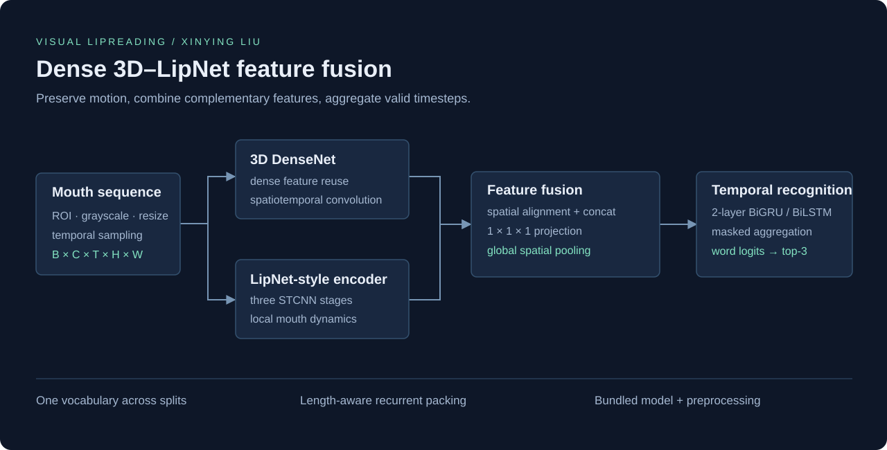
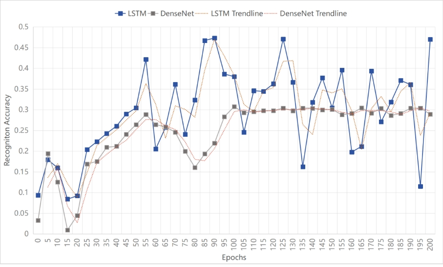
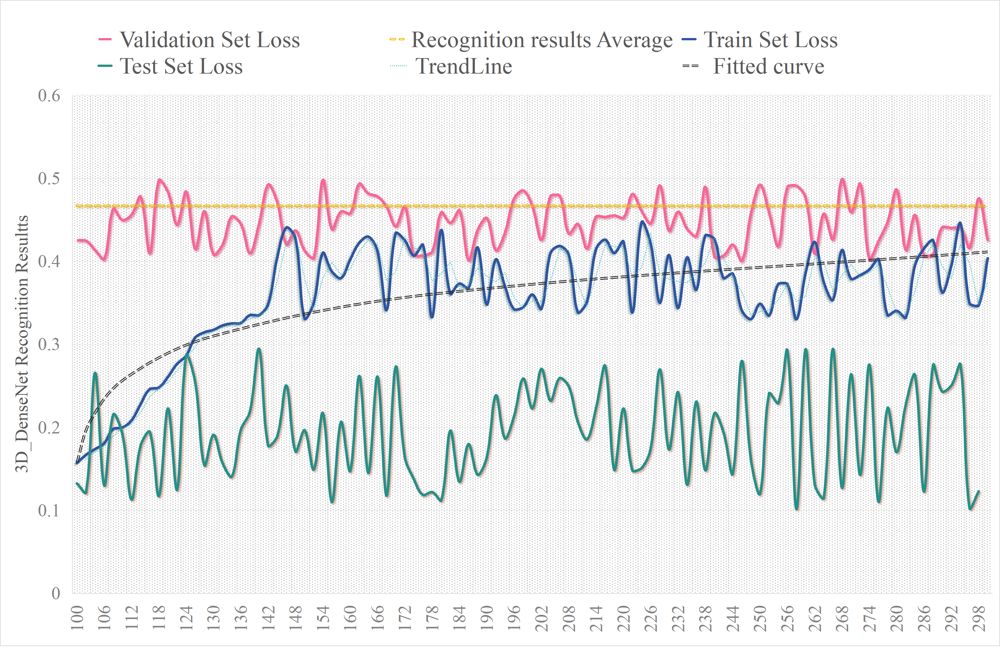
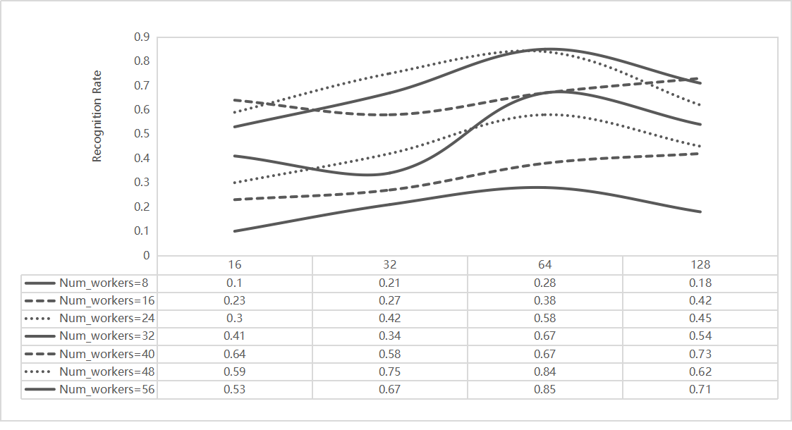
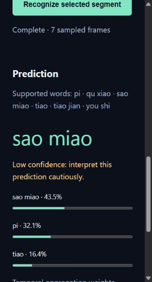

# Visual Lipreading: Dense 3D–LipNet Feature Fusion

**Visual word recognition from mouth motion, with spatiotemporal feature fusion and a bidirectional recurrent backend.**

Author: **Xinying Liu (Ashley Liu)** · Computer Science · Beijing Jiaotong University / Lancaster University College

[Thesis](docs/Xinying-Liu-Lipreading-Thesis.pdf) · [Architecture](docs/ARCHITECTURE.md) · [Experiment protocol](docs/EXPERIMENTS.md) · [Code validation](results/VALIDATION.md) · [Demo](#demo-and-quick-start)



Recognizing speech from video requires modeling both mouth appearance and how it changes over time. This project investigates visual word recognition under lighting changes, variable sequence lengths, speaker variation and ambiguous mouth motion. It builds on my Bachelor thesis, *A Multimodal Lip Recognition Approach Based on Vision and Deep Learning*, and combines **3D DenseNet feature reuse**, a **LipNet-style spatiotemporal branch**, **feature-level fusion** and **two-layer bidirectional recurrence** for word classification.

The executable system is **visual-only, closed-vocabulary recognition**. It predicts one word for an annotated mouth-video segment; it does not require audio or claim sentence transcription.

## Project at a glance

| Component | Design |
|---|---|
| Task | Closed-vocabulary word classification from mouth-video segments |
| Research dataset | LRW-1000, with mouth-region preprocessing and temporal sequences |
| Visual encoder | Parallel Dense 3D and LipNet-style convolutional branches |
| Fusion | Spatially aligned feature concatenation and a learned pointwise projection |
| Temporal backend | Two-layer bidirectional GRU / LSTM, with configurable temporal aggregation |
| Evaluation | Recognition, class-balanced metrics, calibration and robustness probes |
| Demo | Browser video decoding, mouth crop selection, top-3 predictions and local inference |

## Experimental results

The thesis investigates recurrent baselines, dense visual features and an optimized spatiotemporal fusion model. The principal results are:

| Model / evaluation | Recognition rate | Source |
|---|---:|---|
| LSTM — initial model comparison | **35.4%** | Thesis Table 4 |
| DenseNet — initial model comparison | **29.8%** | Thesis Table 4 |
| Optimized 3D DenseNet / LipNet feature fusion — validation | **≈46.73%** | Thesis §4.3.3, Figure 31 |

**Evaluation note:** Table 4 does not name its evaluation split. The fusion result is validation recognition, so the three rows are reported with their original definitions rather than as a matched test-set ranking.

The thesis also gives split-specific LSTM results in §4.2.1:

| Training recognition | Test recognition | Validation recognition |
|---:|---:|---:|
| ≈45.04% | ≈33.78% | ≈21.45% |



*Initial-model trajectories from the thesis defense material, corresponding to the thesis model comparison. DenseNet becomes comparatively stable in the later training stages; the LSTM trajectory varies more strongly.*



*Optimized-model train, validation and test trajectories, corresponding to thesis Figure 31. This image preserves the original figure and legend. The ≈46.73% result refers to validation recognition; the thesis separately describes the test curve around 20%.*

### What the experiments show

The initial comparison motivates studying complementary spatial and temporal representations. The optimized model reaches approximately **46.73% validation recognition**, while the separation between its validation and test curves reveals a substantial generalization gap. This motivates class-balanced evaluation, consistent mouth preprocessing and controlled comparisons of fusion and temporal aggregation.

The figures above preserve the original research trajectories; the [full thesis](docs/Xinying-Liu-Lipreading-Thesis.pdf) contains the surrounding experimental discussion and the [experiment protocol](docs/EXPERIMENTS.md) records the metric definitions.

## Technical approach

### Mouth representation and sequence preparation

The thesis investigates video decoding, face alignment, mouth ROI extraction, smoothing and temporal batching. The maintained package supports pre-cropped mouth frames and a landmark-conditioned ROI adapter:

- Segment-aware frame loading from LRW-style annotations and one shared label vocabulary.
- Landmark-to-mouth geometry, translation/scale-invariant features and local polynomial ROI smoothing.
- Fixed-resolution image normalization with configurable temporal sampling.
- Explicit sequence lengths and masked padding throughout feature extraction and recurrent processing.

### Why combine Dense 3D and LipNet?

A single mouth image cannot capture motion direction or timing. **3D convolution** learns local changes across adjacent frames, while **dense connections** reuse earlier visual features at successive depths. The parallel **LipNet-style branch** provides another spatiotemporal representation. Feature fusion lets the recurrent backend operate on both representations together instead of averaging two final predictions.

### Feature fusion and temporal modeling

The thesis-scale preset uses four dense blocks with layer counts `(4, 8, 12, 8)`, growth rate 32 and 64 initial features. The LipNet-style branch uses three spatiotemporal convolutional stages. Their spatial feature maps are aligned and concatenated **before global spatial pooling**, followed by a learned `1×1×1` projection.

The fused sequence feeds a two-layer **BiGRU** or **BiLSTM**. The model supports final-state aggregation and learned temporal attention. Attention scores are masked at padded positions, and packed recurrence excludes padding from the hidden-state computation.

For input mouth frames $X$, the maintained fusion model computes:

$$
F = P_{1\times1\times1}\!\left([D(X);\,A(L(X))]\right),
\qquad H = \mathrm{BiRNN}(\mathrm{SpatialMean}(F)).
$$

Here $D$ is the Dense 3D branch, $L$ is the LipNet-style branch, $A$ aligns their feature-map sizes and $P$ projects the concatenated channels. With attention aggregation:

$$
\alpha_t = \mathrm{softmax}_t\!\left(w^\top\tanh(W h_t+b)\right),
\qquad z = \sum_{t=1}^{T}\alpha_t h_t,
\qquad \hat y = \mathrm{softmax}(W_c z+b_c).
$$

Padded frames receive no attention mass. The recurrent state uses packed sequences so padding does not become a learned speech cue. A final-state aggregation option supports a controlled comparison with attention.

Configurable encoder ablations include `dense2d`, `dense3d`, `lipnet` and `fusion`. A compact encoder also supports masked mean, recurrent and attention heads for inexpensive pipeline validation.



*The defense material's recurrent-node / worker-count tuning study. The thesis selects 64 recurrent nodes for its parameter study. Worker count is a loading setting, not a model-capacity parameter.*

### Reproducible training and evaluation

- AdamW, cosine learning-rate decay, class-weighted cross entropy and gradient clipping.
- Deterministic seeds and checkpoint selection using **validation balanced accuracy**.
- Test accuracy, balanced accuracy, macro F1, top-3 accuracy, per-class recall and confusion matrices.
- Validation-only temperature scaling; NLL, Brier score and expected calibration error.
- Source-clip bootstrap confidence intervals and post-selection brightness / missing-frame / temporal-order probes.
- A serving bundle that stores weights, model configuration, vocabulary, preprocessing and calibration together.

The main research table follows the thesis. Machine-readable CPU validation records use their actual six-class dataset size and are available in [the validation report](results/VALIDATION.md). They verify the maintained implementation and are not a replacement for the thesis evaluation protocol.

## Demo and quick start

The local demo accepts either a short video or pre-cropped mouth frames. It shares the same preprocessing, vocabulary and inference path as the command-line predictor.



*Actual seven-frame mouth-sequence prediction from the compact demo bundle. The interface displays the predicted label, top-3 scores and temporal aggregation weights.*

### Install

Python 3.10+ is required. A CPU is sufficient for the compact model and local demo.

```powershell
python -m venv .venv
.\.venv\Scripts\Activate.ps1
python -m pip install -e .
```

### Video demo

With the demo checkpoint supplied in the project ZIP:

```powershell
lipreading serve --bundle checkpoints/demo/model.pt --port 8765
```

Open `http://127.0.0.1:8765`, select a short video, choose its word segment and mouth crop, and run recognition. Video decoding happens in the browser; sampled images are sent to the local server. Pre-cropped images can also be selected and are sorted numerically by filename.

Checkpoint binaries are excluded from ordinary Git commits. For a Git clone, supply a compatible serving bundle or follow the training recipe below, then use its `model.pt` path with `--bundle`.

### Prepare data and train

Use your own legally obtained dataset; dataset images are not redistributed in this repository.

```powershell
lipreading prepare --info "PATH/TO/info" --images "PATH/TO/images" "PATH/TO/images1" --out data/cache
lipreading train --cache data/cache --out checkpoints/fusion --architecture fusion --epochs 12 --seed 17
lipreading predict --bundle checkpoints/fusion/model.pt --frames-dir "PATH/TO/MOUTH/FRAMES"
lipreading benchmark --bundle checkpoints/fusion/model.pt
```

The thesis-scale preset is in [configs/thesis-fusion.json](configs/thesis-fusion.json). The class count must match the prepared vocabulary, and image resolution, sequence length and batch size must fit available memory. See the [experiment protocol](docs/EXPERIMENTS.md) for evaluation design and the scripts in `scripts/` for repeated-seed comparisons.

### Implementation verification

The existing verification records contain **25 passing tests** and **10 compact training runs**, including checkpoint reload and browser-to-server inference checks. Their dataset has six classes and 617 / 194 / 90 accepted train / validation / test segments. Full configuration, outcomes and timing scope are available in [results/VALIDATION.md](results/VALIDATION.md).

```powershell
python -m unittest discover -s tests -v
```

The demo predicts within its training vocabulary. Its scores are model probabilities, and the displayed temporal weights describe aggregation rather than causal explanations. A 68-point face detector is not bundled; landmark-based preprocessing accepts supplied landmarks, while the browser provides manual mouth cropping.

## Repository structure

```text
src/lipreading/
  thesis_model.py      Dense 3D, LipNet, fusion, BiGRU/BiLSTM
  model.py             Compact ablations and serving bundles
  preprocessing.py     Landmark geometry and ROI stabilization
  data.py              Annotation audit, preprocessing, cached datasets
  engine.py            Deterministic training, checkpointing, latency
  metrics.py           Classification, calibration, group bootstrap
  inference.py         Shared prediction path
  server.py + web/     Browser video input and local inference UI
configs/               Thesis-scale model preset
scripts/               Reproducible experiment and report commands
tests/                 Model, data, geometry and serving-contract tests
results/               Actual configuration and validation records
docs/                  Thesis, architecture and experiment methodology
assets/                Architecture and source research figures
```

## Research directions

The code supports concrete follow-up experiments: dense-only versus LipNet-only versus fusion; GRU versus LSTM; final-state versus attention aggregation; 48/80/112-pixel resolution; temporal length and frame sampling; class weighting and calibration under label imbalance. Each comparison should fix data partitions and training budget, repeat seeds and report variance.

Audio-visual fusion, sentence-level CTC decoding, pretrained visual speech encoders and automatic face tracking require additional data and evaluation. They are research directions rather than features silently assumed from the paper title.

## Citation and license

```bibtex
@thesis{liu2024lipreading,
  author = {Liu, Xinying},
  title = {A Multimodal Lip Recognition Approach Based on Vision and Deep Learning},
  school = {Lancaster University College at Beijing Jiaotong University},
  year = {2024},
  type = {Bachelor thesis}
}
```

Software is MIT-licensed. The thesis and defense figures retain their academic copyrights; third-party data retains its original terms. The public thesis copy omits student identifiers and administrative signature pages while preserving the research body and references.
